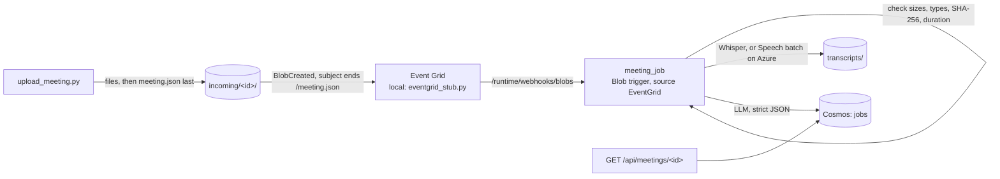

# meeting-summarizer

A meeting recording goes into Blob storage; out comes a summary you can act on: the **decisions**, the **action items with their owners**, and the **open questions**, as strict JSON in Cosmos DB, each item pointing at the moment in the recording that supports it. Built from open components on a laptop (faster-whisper, an LLM on Ollama, Azurite and the Cosmos DB emulator), then the same code serverless on Azure (Functions, Azure AI Speech batch transcription, Azure OpenAI).

**Status: done (M8).** The same code runs on a laptop and serverless on Azure. On the laptop: an upload to Azurite becomes a summary in the Cosmos DB emulator through the Event Grid-based Blob trigger that Flex Consumption uses (M2), with attachments, long meetings and a scored evaluation that chose `qwen3.5:4b` (M3, D33). On Azure (M7, one evening through CI, destroyed the same night): the deployed job transcribed two test meetings with Azure AI Speech batch transcription and summarised them with gpt-5.4-mini, every job at its first attempt, and Speech was compared with Whisper on the same recordings ([results](#results-on-azure-m7), D52). Every PR runs lint, the unit tests, known-bad changes that must fail them, the pipeline against the emulators, a deployment-package gate and the Terraform checks; `main` is protected.

| Step | Local | On Azure (M7) |
|---|---|---|
| Recording arrives | Azurite, `incoming/<meeting-id>/` with `meeting.json` last | Blob storage, Event Grid system topic → the blobs webhook → Blob trigger (Flex Consumption) |
| Speech to text | faster-whisper 1.2.1, Whisper small, CPU, pieces cut at pauses | Azure AI Speech batch transcription (REST 2025-10-15, diarized, Entra token; D44–D46) |
| Summary | `qwen3.5:4b` on Ollama (thinking off, GPU recommended), strict JSON schema | gpt-5.4-mini on Azure OpenAI, strict structured outputs, Entra token |
| Result | Cosmos DB emulator, one job record per meeting | Cosmos DB for NoSQL |

## Run it

Needs uv, Docker, Azure Functions Core Tools 4 and about 3.5 GB of downloads on first use (packages, models).

    uv sync
    uv run python scripts/fetch_models.py stt-small tts-en-libritts
    uv run python scripts/make_meeting.py M01 M02            # synthetic test meetings -> out/meetings/
    docker compose --profile ai up -d && ./scripts/smoke-local.sh
    docker exec meeting-ollama ollama pull qwen3.5:4b
    uv run python scripts/init_stores.py                     # containers and the jobs collection, emulators only
    cp src/local.settings.json.example src/local.settings.json

Then three terminals: `source .venv/bin/activate && cd src && func start` (the Functions host), `uv run python scripts/eventgrid_stub.py` (Event Grid), and:

    uv run python scripts/upload_meeting.py out/meetings/M01.wav --id m01-1 --expect M01
    uv run python scripts/meeting_status.py m01-1 --wait 600

`summarize_file.py` still runs the whole pipeline in one process without the host (M1).

## What the job promises

- Nothing starts before `meeting.json`, the last file of an upload, and nothing reaches a model before every file it lists has the stated size, a supported type read from its bytes, the stated SHA-256, and (the recording) at most 60 minutes (D15, D16). A broken upload fails with a code that says why.
- One job per meeting, whatever Event Grid delivers twice; a retry resumes at the stage reached, and a transcript is never made twice for the same recording (D17, D18). On Azure a Speech batch job is submitted once and kept on the record: a delivery that runs out of waiting time leaves it to the next one, which polls the same job (D45).
- No keys: on Azure the app sends Entra tokens to Azure OpenAI and Speech, and only to their own endpoints (D46).

## What the summary promises

- The JSON shape is fixed (`src/meeting/summary.py`) and sent to the model as a strict schema; lengths and counts are checked after.
- Every evidence time must fall inside a transcript segment, and every owner must be a name that was said or is on the attendee list; anything else is removed and reported, never kept (D4).
- A meeting where nothing was decided gives empty lists: M02 is there to catch a model that invents.
- The transcript is treated as data: what is said in a meeting cannot change the instructions.

## CI

`.github/workflows/ci.yml` runs on every pull request and push to `main`; all seven jobs are required before a merge (the two Terraform ones are under Infrastructure):

| Job | What must hold |
|---|---|
| `lint` | ruff; `uv.lock` current and `src/requirements.txt` exported from it; the decisions index generated from the headings; shellcheck, actionlint; every compose image pinned by digest |
| `unit` | the unit tests (no network, no emulators) |
| `tests-must-fail` | 44 known-bad changes to the code and the Terraform, each caught by the unit tests (`scripts/tests_must_fail.py`) |
| `integration` | the compose lab's Azurite and Cosmos emulator on the runner; the stores, and one meeting spoken by Piper, transcribed by Whisper tiny and summarised by a stand-in model (`scripts/fake_llm.py`) through the real job; and the job with the Speech client against a stand-in of the batch transcription API (`scripts/fake_speech.py`) |
| `package` | the Functions deployment package at most 200 MB zipped, with no PyTorch, GPU runtime, Piper or dev tools in it |

The stand-in model checks the request and the plumbing, not the summary: quality is the evaluation's job (`scripts/eval_meetings.py`, D26), run by hand after a model or prompt change. Locally: `uv run python scripts/tests_must_fail.py`, and with the lab up and `scripts/fetch_models.py stt-tiny tts-en-libritts`, `uv run pytest -m integration`.

## Infrastructure

`infra/` describes the Azure stack (D38–D43): three storage accounts (Function host, recordings, Event Grid dead-letters), an Event Grid system topic on the recordings account whose one subscription sends `meeting.json` events to the Blob trigger's webhook, a Flex Consumption app on a user-assigned identity, Cosmos DB serverless, Azure OpenAI (gpt-5.4-mini), Azure AI Speech for batch transcription, Application Insights, and diagnostics to the shared `log-slz-platform` workspace. No keys anywhere: local auth is off on every service, and each identity gets data roles on single resources or containers.

| Check | What must hold |
|---|---|
| `iac-static` | `terraform fmt` and `validate` of both roots, Checkov per root, the policy unit tests |
| `iac-plan` | the full stack planned against floci-az, every Conftest rule met, and 40 known-bad changes to that plan each denied (`scripts/iac_must_fail.py`) |

Locally: `docker compose --profile iac up -d floci-az && ./scripts/iac.sh wait-floci && ./scripts/trust-floci-cert.sh`, then `./scripts/iac.sh static` and `./scripts/iac.sh gate`.

## Run it on Azure

Deploys go through `.github/workflows/deploy.yml` (D48): GitHub OIDC to Project 1's plan and apply identities, the exact plan gated by Conftest and applied after an approval in the `azure` environment. A session, from the laptop, always in this order and destroyed the same night:

    ./scripts/ci-deploy.sh apply                     # 42 resources; silent 3-5 min while the plan runs, then approve
    ./scripts/ci-deploy.sh deploy-code               # remote build of src/, the three functions listed
    ./scripts/ci-deploy.sh apply --subscription      # + the manifest subscription (1 to add, 1 to change, D51)
    ./scripts/azure_env.sh && source ~/meet-azure.env
    uv run python scripts/upload_meeting.py out/meetings/M01.wav --id m01-az-1 --expect M01
    export APP=$(az functionapp list -g rg-meet-azure --query "[0].name" -o tsv)
    export FUNCTION_KEY=$(az functionapp keys list -g rg-meet-azure -n "$APP" --query functionKeys.default -o tsv)
    uv run python scripts/meeting_status.py m01-az-1 --url "$FUNCTION_URL" --wait 1500
    ./scripts/telemetry.sh "$START" m01-az-          # START = the session's start, UTC; 15 min later
    ./scripts/ci-deploy.sh destroy                   # 43 destroyed; checks the group is gone and nothing soft-deleted
    ./scripts/cost.sh "${START:0:10}"                # the next day: actual cost of rg-meet-azure

`scripts/compare_engines.py` compares Speech with Whisper on a meeting the stack has summarised (D50). Run evidence goes through `scripts/run_evidence.sh` and every evidence file through `scripts/mask_evidence.sh` (D51). The listing of the function key raises Project 2's SLZ-009 for the operator: expected.

## Results on Azure (M7)

Two scripted meetings (M01: three speakers, decisions and owners; M02: nothing decided), the same recordings through the deployed job and through Whisper on the laptop, every summary by the stack's gpt-5.4-mini ([m7-compare-M01](docs/evidence/m7-compare-M01.md), [m7-compare-M02](docs/evidence/m7-compare-M02.md), [the jobs](docs/evidence/m7-azure-runs.md)):

| | Speech batch (Azure, uaenorth) | Whisper `stt-small` (laptop CPU, names as hotwords) |
|---|---|---|
| WER against the script, M01 / M02 | 5.2 % / 3.1 % | 4.5 % / 1.6 % |
| Speakers labelled | 3 of 3 / 2 of 2 | none (no diarization) |
| Attendee names heard as spelled on the list, M01 / M02 | Omar / Omar ("Lena" for Lina in both) | Omar, Lina / Lina, Omar |
| Transcription time, M01 / M02 | 95 s / 61 s (submit to result) | 28.6 s / 13.1 s |
| Summary checks, M01 / M02 | 7 of 8 / 6 of 6 (Lina's owner removed by grounding) | 7 of 8 / 6 of 6 (two evidence times off) |

The deployed job function ran 79 s at the median and 113 s at most (AppRequests), every job at attempt 1 and delivery 1; the summaries took 2.9 s and 1.6 s. Speech read the recordings with its own identity, without a SAS (D3, [telemetry](docs/evidence/m8-telemetry.txt)). The evening cost under 0.01 USD ([m7-cost.txt](docs/evidence/m7-cost.txt)).

**Choice (D52):** Speech batch transcription on Azure, Whisper on the laptop. Speech runs serverless without a model in the package and labels speakers; its accuracy here is within a point of Whisper's. Its cost is names: there is no phrase list, so a misheard name loses its owner (safely: an empty owner, never a wrong one). Two synthetic meetings are a first contact, not a ranking.

## On a Kubernetes cluster (Project 7)

The same app runs as a tenant of [secure-ai-platform](https://github.com/salmanamn/secure-ai-platform) (its M4): a Functions container (D54) whose job reads the manifest's event from a storage queue instead of an Event Grid webhook (D55), deployed with the Helm chart in `deploy/chart/meeting-summarizer` (two deployments, KEDA from zero on the queue, a Job for Whisper's files, D56). CI checks the chart and the image (D57); the image is not published (PyAV's bundled FFmpeg, D54): the platform takes CI's artifact into its own registry. On the laptop: `docker compose -f docker-compose.yml -f docker-compose.cluster.yml up -d` puts the emulators on minikube's network, and `uv run python scripts/eventgrid_stub.py --config emulators/eventgrid/cluster.json` stands in for Event Grid.

## Known limits

- Synthetic test meetings (D7) and a few AMI corpus meetings locally (D33); no real recordings on Azure, no Arabic, no overlapping speech.
- Two of D33's local gates are unmet (owner right, source right with `qwen3.5:4b`); the tuning set was not run against gpt-5.4-mini.
- Names without hints on Azure (D52). Scanned PDFs are not read (no OCR, D22).
- Public endpoints with Entra ID only, no private endpoints (D39). azurerm 4.81's key-based `AzureWebJobsStorage` on Flex apps is removed after every apply by `scripts/fix-host-storage.sh` (Project 3 D23).

## What was measured locally

Two scripted meetings spoken by Piper with three voices ([eval/meetings](eval/meetings), D7) and the results in [docs/evidence](docs/evidence). Synthetic audio says nothing about real rooms, accents or people talking over each other; M3 added real meetings from the AMI corpus (CC BY 4.0) to the evaluation, with the results in D33. One finding already shaped the code: Whisper's own sliding window silently dropped whole lines in some runs of the same meeting, so long recordings are cut at pauses instead (D13).

Design choices and their reasons: [docs/decisions.md](docs/decisions.md) ([index](docs/decisions-index.md)); the state at the close is D53.

MIT licence ([LICENSE](LICENSE)).