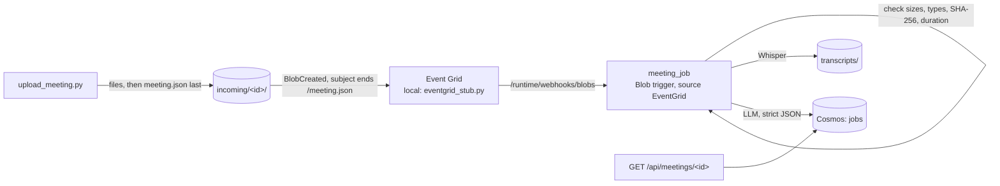

# meeting-summarizer

A meeting recording goes into Blob storage; out comes a summary you can act on: the **decisions**, the **action items with their owners**, and the **open questions**, as strict JSON in Cosmos DB, each item pointing at the moment in the recording that supports it. Built from open components on a laptop (faster-whisper, an LLM on Ollama, Azurite and the Cosmos DB emulator), then the same code serverless on Azure (Functions, Azure AI Speech batch transcription, Azure OpenAI).

**Status: M2 — the Functions app runs on the laptop:** an upload to Azurite becomes a summary in the Cosmos DB emulator, through the same Event Grid-based Blob trigger that Flex Consumption uses. Nothing on Azure yet.

| Step | Local | Planned on Azure |
|---|---|---|
| Recording arrives | Azurite, `incoming/<meeting-id>/` with `meeting.json` last | Blob storage, Event Grid system topic → Blob trigger (Flex Consumption) |
| Speech to text | faster-whisper 1.2.1, Whisper small, CPU, pieces cut at pauses | Azure AI Speech batch transcription (REST 2025-10-15), or the same Whisper |
| Summary | `phi4-mini:3.8b` on Ollama, strict JSON schema | gpt-5.4-mini on Azure OpenAI, strict structured outputs |
| Result | Cosmos DB emulator, one job record per meeting | Cosmos DB for NoSQL |

## Run it

Needs uv, Docker, Azure Functions Core Tools 4 and about 3.5 GB of downloads on first use (packages, models).

    uv sync
    uv run python scripts/fetch_models.py stt-small tts-en-libritts
    uv run python scripts/make_meeting.py M01 M02            # synthetic test meetings -> out/meetings/
    docker compose --profile ai up -d && ./scripts/smoke-local.sh
    docker exec meeting-ollama ollama pull phi4-mini:3.8b
    uv run python scripts/init_stores.py                     # containers and the jobs collection, emulators only
    cp src/local.settings.json.example src/local.settings.json

Then three terminals: `source .venv/bin/activate && cd src && func start` (the Functions host), `uv run python scripts/eventgrid_stub.py` (Event Grid), and:

    uv run python scripts/upload_meeting.py out/meetings/M01.wav --id m01-1 --expect M01
    uv run python scripts/meeting_status.py m01-1 --wait 600

`summarize_file.py` still runs the whole pipeline in one process without the host (M1).

## What the job promises

- Nothing starts before `meeting.json`, the last file of an upload, and nothing reaches a model before every file it lists has the stated size, a supported type read from its bytes, the stated SHA-256, and (the recording) at most 60 minutes (D15, D16). A broken upload fails with a code that says why.
- One job per meeting, whatever Event Grid delivers twice; a retry resumes at the stage reached, and a transcript is never made twice for the same recording (D17, D18).

## What the summary promises

- The JSON shape is fixed (`src/meeting/summary.py`) and sent to the model as a strict schema; lengths and counts are checked after.
- Every evidence time must fall inside a transcript segment, and every owner must be a name that was said or is on the attendee list; anything else is removed and reported, never kept (D4).
- A meeting where nothing was decided gives empty lists: M02 is there to catch a model that invents.
- The transcript is treated as data: what is said in a meeting cannot change the instructions.

## What is measured so far

Two scripted meetings spoken by Piper with three voices ([eval/meetings](eval/meetings), D7) and the results in [docs/evidence](docs/evidence). Synthetic audio says nothing about real rooms, accents or people talking over each other; real recordings come in M3. One finding already shaped the code: Whisper's own sliding window silently dropped whole lines in some runs of the same meeting, so long recordings are cut at pauses instead (D13).

Design choices and their reasons: [docs/decisions.md](docs/decisions.md) ([index](docs/decisions-index.md)).